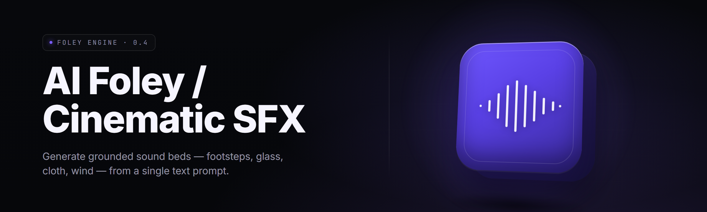

  
  
  

  

  
  
  

---

**Turn a one-line prompt into frame-accurate cinematic foley — footsteps, cloth, glass, weather, impacts, and room tone — rendered locally in under three seconds.**

---

## 🎬 Table of Contents
- [🎬 Table of Contents](#-table-of-contents)
- [🔊 Overview](#-overview)
- [❓ FAQ](#-faq)
- [📦 Grouped Module Catalog](#-grouped-module-catalog)
  - [🦶 Foot & Surface Foley](#-foot--surface-foley)
  - [🧵 Cloth, Armor & Prop Motion](#-cloth-armor--prop-motion)
  - [💥 Impact, Damage & Destruction](#-impact-damage--destruction)
  - [🌧️ Weather, Room Tone & Ambience](#️-weather-room-tone--ambience)
  - [🎚️ Mix, Sync & Delivery](#️-mix-sync--delivery)
  - [🧠 Model & Rendering Core](#-model--rendering-core)
- [🎛️ Key Features](#️-key-features)
- [📊 All Modules Status](#-all-modules-status)
- [💡 The Solution](#-the-solution)
- [🩹 Known Issues](#-known-issues)
- [🚀 Quick Start (Get Started)](#-quick-start-get-started)
- [🖥️ Compatibility / Platform Support](#️-compatibility--platform-support)
- [⚖️ Comparison](#️-comparison)
- [📖 What is a Foley Generator?](#-what-is-a-foley-generator)
- [🧭 The Problem](#-the-problem)
- [📥 Installation](#-installation)
- [🧰 System Requirements](#-system-requirements)
- [🏁 Closing Notes](#-closing-notes)

  

---

## 🔊 Overview

**ai-foley-sfx-generator** is a Windows `.exe` that generates cinematic foley and sound effects from timing data, prompts, or a video timeline. Drop in an EDL, a `.wav` guide track, or an exported edit — the app matches footsteps to feet, cloth to motion, impacts to cuts, and renders a layered stem pack you can drop straight into your DAW.

| Category | Details |
| --- | --- |
| Release | v2.4.1 · Windows `.exe` · 2026 |
| Engine | Local ONNX Runtime · GPU-optional (CUDA / DirectML) |
| Inputs | Prompt text, .edl, .csv cue sheet, guide audio, .mp4 reference |
| Outputs | Stereo + 5.1 stems, .wav 48 kHz / 24-bit, per-event cue markers |
| Workflow | Import → auto-detect events → tune → render → export stems |
| License | MIT — hobby, film, game, mod, and student use |

---

## ❓ FAQ

<b>Is this a cloud service or does it run offline?</b>

Fully offline. The `.exe` ships with an embedded ONNX runtime and a default model bundle. No account, no upload, no network call after install.

<b>Do I need a GPU?</b>

No. The CPU path renders a 60-second cue sheet in roughly 20–40 seconds on a modern 8-core. A discrete GPU drops that to ~2–5 seconds for the same sheet.

<b>Can it sync to my editing timeline?</b>

Yes. Import your NLE `.edl` or `.csv` cue sheet with timecodes, and every generated event lands on the frame. Cue markers are written back as a `.csv` sidecar.

<b>What audio format does it export?</b>

48 kHz / 24-bit `.wav` by default. 5.1 and mono downmix are one click. Stems are labeled by category (foot, cloth, impact, ambience).

<b>Does it work on Steam Deck?</b>

Via Proton / Bottles. The `.exe` is Windows-only; Steam Deck users run it through a compatibility layer. Rendering performance depends on Proton version.

<b>Can I train or swap models?</b>

Drop a compatible `.onnx` bundle into the `models/` folder. The app auto-discovers new bundles and lists them in the model picker.

<b>Does it detect events in video?</b>

Yes. Import a reference `.mp4` and it analyzes motion, contact, and energy changes to suggest cue points — you approve before rendering.

<b>Will it overwrite my audio files?</b>

No. It writes to a chosen output folder and never touches source files. Irreversible operations (batch overwrite, model deletion) always prompt for confirmation first.

<b>Is there a CLI for batch jobs?</b>

Yes — the `.exe` accepts a `--batch` flag with a job spec JSON, useful for modding pipelines and CI render farms.

---

## 📦 Grouped Module Catalog

### 🦶 Foot & Surface Foley

- **Footstep Weaver** — matches step cadence to guide audio and locks foot placement to detected contact frames.
- **Surface Matrix** — 60+ surfaces (wet gravel, marble, snow crust, grille metal, ship deck) with layered variation.
- **Shoe Type Router** — routes each step to sneaker, boot, heel, barefoot, or armored tread by shoe tag.
- **Gait Modifier** — smooth, injured, sneaking, sprint — rebuilds cadence and pressure without re-rendering stems.

### 🧵 Cloth, Armor & Prop Motion

- **Cloth Rustle Synth** — denim, leather, silk, parachute nylon with intensity driven by motion energy.
- **Armor Rattle Bank** — plate clatter, chain jingle, buckle snaps, scaled by rig motion curve.
- **Prop Motion Layer** — sword draw, holster click, gear clip, magazine seat, keychain jangle.
- **Hair & Costume Flap** — cloak, kilt, tailcoat flap synced to wind or velocity curves.

### 💥 Impact, Damage & Destruction

- **Contact Impact Kit** — fist, head, body slam, wood crack, glass break, metal dent.
- **Debris Tail Generator** — granular debris tails after each impact, tunable decay and scatter.
- **Blood & Wet Layer** — squelch, gush, splatter, wet slap toggleable per event.
- **Vehicle Body Layer** — door slam, panel dent, tire chirp, exhaust pop, hood latch.

### 🌧️ Weather, Room Tone & Ambience

- **Weather Beds** — rain light/heavy, hail, sleet, wind gust layers with LFO modulation.
- **Room Tone Fitter** — matches scene reverb tail to detected space (hall, closet, cavern, alley).
- **Interior/Exterior Morph** — crossfades between dry interior and open exterior beds.
- **Distraction Layer** — birds, sirens, distant traffic, cicadas — auto-mixed under dialogue.
- **Underwater & Muffled Bed** — band-limited tone shift for submerged or through-wall POV.

### 🎚️ Mix, Sync & Delivery

- **Stem Pack Exporter** — stereo, 5.1, mono downmix, per-category stems.
- **Loudness Matcher** — target -23 LUFS / -14 LUFS / EBU R128 presets.
- **Cue Sheet Writer** — exports `.csv` cue markers aligned to NLE timeline.
- **DAW XML Bridge** — session XML with stems, names, and timecodes pre-mapped.
- **Batch CLI** — `--batch job.json` for render farms and mod pipelines.

### 🧠 Model & Rendering Core

- **Prompt-to-SFX Model** — text → layer bank with semantic category routing.
- **Timeline Detector** — motion/energy analysis over reference `.mp4`.
- **Model Bundle Manager** — swap or install additional `.onnx` bundles.
- **Deterministic Seed** — reproducible renders for version-locked edits.
- **GPU / CPU Renderer** — ONNX Runtime with CUDA or DirectML backend.
- **Cache & Library** — deduplicated event cache for near-instant re-renders.

---

## 🎛️ Key Features

| Feature | Description | Benefit |
| --- | --- | --- |
| Offline render | All inference runs on-device via ONNX Runtime | No upload, no account, no queue |
| Timeline sync | EDL / CSV / MP4 cue import with frame accuracy | Watch picture match the track |
| 60+ surface bank | Curated surfaces with layered variation | No more stock footstep fatigue |
| Multi-stem export | Per-category stems and 5.1 upmix | Drops straight into your DAW |
| Model picker | Swap `.onnx` bundles in-folder | Extend without reinstall |
| Batch CLI | `--batch` job spec for pipelines | Mod & CI friendly |
| Loudness presets | R128 / -23 / -14 targets | Broadcast-ready on first bounce |
| Cue markers | `.csv` sidecar with timecode | Round-trip with edit |
| Deterministic seed | Byte-identical re-render | Locked cuts stay locked |
| GPU optional | CUDA / DirectML / CPU | Runs on anything |
| Mod-community ready | Plain folders, no registry writes | Easy to fork and package |

---

## 📊 All Modules Status

| Module | Status | Description |
| --- | --- | --- |
| Footstep Weaver | ✅ Working | Cadence-locked foot placement |
| Surface Matrix | ✅ Working | 60+ surface router |
| Cloth Rustle Synth | ✅ Working | Fabric-bank generator |
| Armor Rattle Bank | ✅ Working | Plate & chain layers |
| Contact Impact Kit | ✅ Working | Fist, wood, glass, metal |
| Debris Tail Generator | ✅ Working | Granular post-impact tails |
| Weather Beds | ✅ Working | Rain, hail, wind |
| Room Tone Fitter | ✅ Working | Reverb tail matcher |
| Stem Pack Exporter | ✅ Working | Stereo, 5.1, mono |
| Timeline Detector | ✅ Working | MP4 motion analysis |
| Prompt-to-SFX Model | ✅ Working | Text → layer bank |
| Batch CLI | ✅ Working | `--batch job.json` |
| Model Bundle Manager | ✅ Working | Drop-in `.onnx` swap |
| DAW XML Bridge | 🟡 Beta | Session XML export |
| Underwater Bed | 🟡 Beta | Band-limited tone shift |
| Distraction Layer Auto | 🟡 Beta | Auto-duck under dialogue |

---

## 💡 The Solution

| Problem | Solution |
| --- | --- |
| Stock footstep libraries sound identical | Weaver varies pitch, weight, and surface per step |
| Hand-placing cues across a 90-minute cut | Timeline Detector suggests cues, you approve |
| Cloud SFX tools upload your edit | Full offline `.exe`, no network call after install |
| Stems arrive glued to one stereo file | Per-category stem pack with DAW-ready labels |
| Model swaps need a reinstall | Drop `.onnx` into `models/`, app picks it up |
| Broadcast loudness compliance is manual | One-click R128 / -23 / -14 targets |

---

## 🩹 Known Issues

| Issue | Solution |
| --- | --- |
| DirectML backend slower than CUDA on some AMD cards | Force CPU or enable GPU-only render in Settings |
| MP4 detector flags ambient motion as cue | Raise motion threshold in Detector panel |
| 5.1 export clips on very dense impact stacks | Enable Bus Limiter before render |
| Steam Deck render stutters under Proton 8 | Use Proton 9+ or Bottles with DXVK |
| `.edl` from older Premiere exports dropped frame offsets | Re-export EDL as CMX3600 with frame base set |

---

## 🚀 Quick Start (Get Started)

1. 🎬 Visit the project page and hit **

  

**.
2. 📦 Extract the `.zip` to a folder you own (avoid `Program Files`).
3. ⚙️ Run the `.exe`. On first launch, pick a model bundle.
4. 🎧 Drag a guide `.wav` or `.edl` onto the timeline.
5. 🎚️ Hit **Render**, then **Export Stems** to your DAW folder.

---

## 🖥️ Compatibility / Platform Support

| Platform | Support | Notes |
| --- | --- | --- |
| 🪟 Windows 11 | ✅ Native | Primary target, GPU-optional |
| 🪟 Windows 10 | ✅ Native | 21H2 or newer |
| 🎮 Steam Deck | ✅ via Proton | Bottles / Proton 9 recommended |
| 🐧 Linux (Wine) | 🟡 Community | Works, no official installer |
| 🍎 macOS | ❌ | Not supported in 2026 |
| 💬 Discord share | ✅ | Exported stems drag-and-drop |

---

## ⚖️ Comparison

| Aspect | Alternative | This Tool |
| --- | --- | --- |
| Hosting | Cloud SaaS | Fully offline `.exe` |
| Pricing | Subscription | MIT, one-time download |
| Timeline sync | Manual cue entry | EDL / CSV / MP4 import |
| Stems | Single stereo mix | Per-category stem pack |
| Model swap | Vendor-locked | Drop-in `.onnx` folder |
| Batch | Rare | CLI `--batch` jobs |
| Surface bank | Small fixed set | 60+ routed surfaces |
| Privacy | Upload required | Nothing leaves disk |

---

## 📖 What is a Foley Generator?

| Term | Explanation |
| --- | --- |
| Foley | Everyday sound — steps, cloth, props — performed to picture |
| Stem | Isolated category track (foot, cloth, impact, ambience) |
| Cue sheet | `.csv` map of event name + timecode |
| EDL | Edit Decision List from an NLE (CMX3600 etc.) |
| Room tone | The base ambience of a space |
| Bed | Continuous ambience layer under dialogue |
| ONNX | Open model format used by the local runtime |
| LUFS | Loudness unit used for broadcast compliance |

Key benefits:
- Footsteps stop sounding copy-pasted.
- Stems arrive ready for mix.
- Nothing uploads — your edit stays on disk.
- Drops into Premiere, Resolve, Reaper, or a mod pipeline.
- Model picker keeps the tool alive as new bundles land.

---

## 🧭 The Problem

- Stock footstep packs flatten every character to one sneaker.
- Cloud SFX tools force you to upload unfinished cuts.
- Hand-placing 400 cues eats a weekend.
- Stems never match your mix template on the first bounce.
- Broadcast loudness targets require a second pass in a meter plugin.
- Modding pipelines need batch render, not a GUI clickfest.
- Model swaps mean a reinstall, reauth, and re-download.

---

## 📥 Installation

1. Download and extract the `.zip` to a drive you own.
2. Launch the `.exe`. If Windows SmartScreen blocks it, choose **More info → Run anyway** (unsigned indie build).
3. On first run, point the model picker at the bundled `models/` folder and confirm the render backend (CPU or GPU).

  

---

## 🧰 System Requirements

| Component | Minimum | Recommended |
| --- | --- | --- |
| OS | Windows 10 21H2 | Windows 11 23H2+ |
| CPU | 4-core x86-64 | 8-core Ryzen 5 / i5 12th gen |
| RAM | 8 GB | 16 GB |
| GPU | Integrated | 6 GB VRAM (CUDA / DirectML) |
| Storage | 4 GB free | 10 GB SSD |
| Audio | Any WASAPI device | 48 kHz monitoring DAC |

---

## 🏁 Closing Notes

Every step, cloth grab, and glass shatter in your cut now sings in the same room as the picture. Render it, swap a model, run a batch — the app stays a folder you own on a disk you own. The model picker, the batcher, and the surface bank are what make it a pipeline instead of a preset. Name your next cue sheet, chef — the fridge is closed and the render bay is hot.
</｜｜DSML｜｜ parameter>
</｜｜DSML｜｜ invoke>
</｜｜DSML｜｜ calls>
